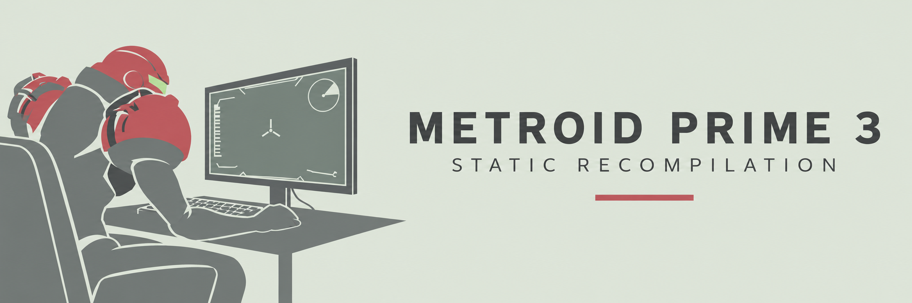

  

# Corruption_3 PC

A native Windows port of **Metroid Prime 3: Corruption** (Wii, USA), created by **bonllavier**.
The game's program code runs recompiled on your PC: no emulator, no virtual machine. You play with keyboard and mouse
(or a real Wii Remote over Bluetooth), at your monitor's resolution, with per-pixel lighting, anisotropic
filtering and MSAA on top of the original look.

> ## ⚠️ Testing phase: testers wanted
>
> **This release is a test build, not a finished port.** The game boots, loads saves and the start of the campaign
> (G.F.S. Olympus, Norion) plays at 60 FPS; most of the Wii Remote and Nunchuk gestures are already mapped to keys.
> Everything after that has not been played end to end, so expect missing textures, crashes, soft-locks and untested
> gestures. I need people to play it and tell me where it breaks.
>
> **How to help:** play, and when something goes wrong press **F12** in game. The port writes a small zip with a
> screenshot, the session log and your settings. Post it in **[Discussions](../../discussions)** (category *Bug reports*)
> together with **where you were in the game**. That one detail lets me go there and reproduce it. Performance problems
> only need the area name. Thank you!

**No game assets are included.** You need your own dump of the disc. See [Legal](#legal).

---

## Requirements

| | Minimum |
| --- | --- |
| OS | Windows 10 or 11, 64-bit |
| CPU | x86-64-v3 (Intel Haswell / 4th gen or newer, AMD Excavator / Zen or newer) |
| GPU | Direct3D 12 or Vulkan capable, up to date drivers |
| RAM | 8 GB |
| Game | Your own dump of *Metroid Prime 3: Corruption* (USA), game ID `RM3E01`, as `.iso`, `.rvz`, `.wbfs`, `.gcz`, `.wia` or `.ciso` |

## Getting started

1. Download the latest `Corruption_3-PC-vX.Y.Z-win64.zip` from the [Releases](../../releases) page and unzip it anywhere.
2. Run **`Corruption_3 PC.exe`**. On the first start it asks for your disc image: pick the file in the dialog.
   The path is saved in `UserData/Config.toml`, so you are asked only once (change it later in **F1 > Diagnostics > Select disc image**).
3. The first start compiles shaders for a few seconds. Pick your save slot with the mouse and click. **F1** opens the options at any time.

Everything the port writes (settings, saves, logs, caches, bug reports) stays inside its own `UserData` folder next to the
executable. The disc image is only ever read, wherever it lives.

## Updating to a new version

Unzip the new release **over the same folder** and overwrite when asked. The zip never contains `UserData`, so your
saves, settings, key bindings and the remembered disc image path are kept. Nothing else is needed; the shader cache
is upgraded automatically on the next start.

## Controls

The port drives a virtual Wii Remote and Nunchuk. Every key can be remapped in **F1 > Controls**; the game's own button prompts show your keys instead of Wii buttons.

| Keyboard / mouse | Wii |
| --- | --- |
| Mouse | Aim. In first person the camera follows the mouse (mouse look) |
| Left click / Enter | A |
| Right click / Space | B |
| W A S D | Nunchuk stick |
| Shift | Z (lock on) |
| Ctrl | C (Morph Ball) |
| Arrow keys (middle click = down) | D-pad |
| 1 | + (pause / menu) |
| 2 | - (visor select) |
| Numpad 1, Numpad 2, H | 1, 2, HOME |
| E / Q (hold, release) | Push the remote forward / pull it back (levers, ship controls) |
| Z / X (or Numpad 7 / 8) | Twist the remote left / right |
| R / F | Flick the Nunchuk: grapple lasso throw / pull |
| T | Flick the remote up (Morph Ball spring jump) |
| G (hold), U/J, N/M, I/K | Shake both, tilt remote, twist Nunchuk, tilt Nunchuk |

Full table and gesture notes: [docs/controls.md](docs/controls.md).

### Hotkeys

| Key | Action |
| --- | --- |
| F1 | Port options: video, controls, audio, performance, diagnostics |
| F10 | Renderer bar (resolution, display mode, Wii Remote pairing, audio) |
| F12 | **Create a bug report** (screenshot + log + settings, zipped; the file name carries the version) |
| F11 | **Screenshot**: the game picture with the image effects, without the port's menus, saved as JPEG in `UserData/Screenshots` (`Corruption3PC_v<version>_<build>_<date>_<time>.jpg`) |
| F9 | Performance panel |
| F6 | Virtual Wii Remote motion panel |
| Esc | Exit prompt |

## Version and updates

**F1 > Info** shows the exact build you are running (version, build date), the paths in use and whether a newer
release exists: at startup the port sends one request to `api.github.com` for the latest release and shows a green
notice for a few seconds when there is a newer one (turn it off in that tab or with `check_updates = false`).
`Check for updates.ps1` in the game folder does the same from PowerShell. Every F12 report also records the version
in its file name (`report_<date>_v0.1.0.zip`) and in `system.txt`, so please always report with the latest build.

## Reporting bugs

Press **F12** when something looks wrong. The port writes `UserData/Reports/report_<date>.zip` with a screenshot, the
console log of that session, your settings and a system summary, then opens the folder for you. Post the zip in
[Discussions](../../discussions) (*Bug reports*) and say **where in the game you were** (planet, room, what you were doing).

If the game closes with an error dialog, the dialog names the `UserData/Logs/...` folder of that run. Zip that folder and attach it.
Nothing personal is collected: you can open every file in the zip before posting it. See [docs/troubleshooting.md](docs/troubleshooting.md).

## Options worth knowing (F1)

- **Video**: internal resolution (monitor native by default), MSAA 2x/4x/8x, anisotropic filtering, per-pixel lighting, enhanced metal (modern metal material on the suit, armour and machinery; skin is left alone; on by default), enhanced materials (the same treatment for identified surfaces such as the starship hulls; on by default), console copy filter (the Wii's vertical blur, off by default), frame interpolation to 120/180 Hz (off by default).
- **Controls**: key bindings, mouse look sensitivity and smoothing, keyboard icons in game prompts, hide cursor, always-full Wii Remote battery.
- **Audio**: volume, stereo / Pro Logic II / mono, high-quality resampler.
- **Performance**: GPU thread, disc reads on their own thread, texture decoding on several cores, shader waiting policy, and the experimental *ubershader* (see below). The game logic always runs at 60 Hz, like the console.

## Please read: shaders, stutter and the cache

The Wii draws with a fixed-function GPU whose state (texture stages, blending, lighting, fog...) the game changes
thousands of times per frame. On a PC each distinct combination has to become a real shader program, compiled by your
graphics driver for *your* GPU. The port cannot know every combination in advance, so:

- **The first time a material appears on your PC, its shader is compiled.** That is the hitch you feel when you enter
  a new room, meet a new enemy or fire a new weapon for the first time. The port ships a seed of every combination seen
  so far (thousands of them) and compiles it in the background at startup, which is why the first launch takes a few
  seconds longer; areas nobody has played yet still compile on sight.
- **Compiled shaders are kept in `UserData/Cache`.** The next visit to the same place, and the next launch, do not
  compile again: once the cache has filled for an area, the stutter there is gone. Do not delete that folder unless
  troubleshooting.
- **What to report:** a hitch the *first* time you see something is expected and not worth a report. A stutter that
  keeps happening in the same place on later visits, or constantly low FPS, is a real problem: post it with the area
  name and, ideally, an F9 performance panel screenshot.
- **How you can make it better for everyone:** after playing new areas, your `UserData/Cache/pipeline_cache.db`
  contains the recipes (not shaders, not game data, a few MB) of everything you rendered. Attaching it to a Discussions
  post lets the next release ship them pre-seeded, so other players never compile them.
- The option *F1 > Performance > "Experimental: do not wait for new shaders"* (on by default) keeps the frame rate
  up during compilation by skipping a draw for a fraction of a second instead of freezing the whole game; if you see a
  piece of a room pop in late, that is this option doing its job.
- *F1 > Performance > "Ubershader while shaders compile"* (on by default) goes one step further: while
  a material's shader compiles, it is drawn with a generic shader that reads the material from memory, so nothing is
  skipped and nothing waits. Compiled shaders and the cache always have priority; the ubershader only covers the gap.
  It adds about 100 MB to the shader cache and a couple of seconds to start-up, and costs some GPU time during those
  few frames. Every release is scanned with VirusTotal and the report is linked in its notes.

## Image effects (F1 > Effects)

Two ways to tune the look:

- **Aurora effects** (built in, apply instantly, cost little): ambient occlusion from the depth buffer (**on by
  default**: soft contact shading in corners and where objects meet, applied to the 3D world only, never to the visor
  or HUD, and never to Samus' face or her body out of the suit; needs MSAA off; *Reset SSAO* restores the tuned defaults), extra bloom/glow, CAS sharpening, FXAA, and colour
  grading (brightness, contrast, saturation, gamma, temperature, vignette), which are off by default. The game's own
  bloom and lighting are untouched.
- **ReShade** (bundled in the `reshade` folder, BSD licence): tick *Load ReShade at startup* in F1 > Effects and restart.
  In game, **Home** opens the ReShade menu with every effect and parameter, **End** toggles all effects, **Print Screen**
  saves a screenshot. ReShade effects pause automatically in menus, the map, videos and while a port panel (F1, F10,
  F9, F6) is open, so they never touch those screens. A starter preset enables CAS and SMAA; the bundled set also has FXAA, LumaSharpen, MagicBloom,
  AmbientLight, Vibrance, Tonemap, Curves, Levels, LiftGammaGain, Vignette and LUT. Direct3D 12 only.

Effects are post-processing: they cannot add texture detail, and heavy ReShade shaders cost frame time. If you report a
visual glitch, say whether any effect or ReShade was active (the F12 report records your settings).

## Known issues

- Experimental texture upscaling (Super-xBR) can paint some polygons magenta; it is off by default.
- Bluetooth Wii Remote support exists but has had far less testing than keyboard and mouse.
- Only the USA disc (RM3E01, revision 0) is supported.

## Legal

This is a non-commercial fan project with no affiliation to Nintendo or Retro Studios. *Metroid* and *Metroid Prime*
are trademarks of Nintendo.

- The release contains **no game assets**: no textures, models, audio, videos, text or levels. All of that is read at
  run time from the disc image you dump from your own copy of the game, which is never modified.
- The executable contains the game's **program logic translated to native code** (static recompilation), the way other
  recompilation projects work. It is unusable without the original disc. If you do not own the game, do not download this.
- Do not ask for, offer or link disc images anywhere in this project. Such posts are removed.

The port is built on [WiiCompiled](https://github.com/WiiCompiled) and its Aurora renderer and is licensed under the
[GNU GPL v3](LICENSE). Third-party components and their licenses are listed in [THIRD-PARTY-NOTICES.md](THIRD-PARTY-NOTICES.md).

## Credits

- **bonllavier**: port creator, Metroid Prime 3 runtime hooks, keyboard/mouse mode, PC options.
- WiiCompiled authors: static recompilation runtime and Aurora (GX on WebGPU/Dawn).
- nod (disc image reader), Dawn, SDL3, Dear ImGui, Super-xBR by Hyllian, and everyone in THIRD-PARTY-NOTICES.md.
