

  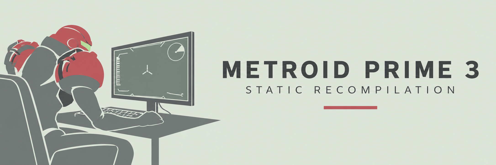

# Corruption_3 PC - Metroid Prime 3: Corruption static recompilation (recomp) for Windows and Linux

A native Windows and Linux port of **Metroid Prime 3: Corruption** (Wii, USA), created by **bonllavier**. It also runs
the Metroid Prime 3 of **Metroid Prime Trilogy** (USA) through an optional add-on.
The game's program code runs recompiled on your PC: no emulator, no virtual machine. You play with keyboard and mouse
or a gamepad, at your monitor's resolution, with per-pixel lighting, enhanced materials, ambient occlusion, floor and
wall reflections, anisotropic filtering and MSAA on top of the original look.

> **Controllers:** the port is played with **keyboard and mouse** or a **gamepad** (Xbox, PlayStation, Switch Pro and
> similar). A **real Wii Remote is not playable yet**: the port can read its buttons, motion and the Nunchuk over
> Bluetooth, but not the IR pointer, and Prime 3 needs the pointer to aim and turn. Proper Wii Remote support (pointer
> and sensor bar) should come later.

> ## ⚠️ Testing phase: testers wanted
>
> **This release is a test build, not a finished port.** The game boots, loads saves and the start of the campaign
> (G.F.S. Olympus, Norion, Bryyo up to the fight with Rundas) plays at or near 60 FPS; most of the Wii Remote and Nunchuk
> gestures are already mapped to keys and to the gamepad.
> Everything after that has not been played end to end, so expect missing textures, crashes, soft-locks and untested
> gestures. I need people to play it and tell me where it breaks.
>
> **How to help:** play, and when something goes wrong press **F12** in game. The port writes a small zip with a
> screenshot, the session log, your settings and your save. Post it in **[Discussions](../../discussions)** (category *Bug reports*)
> together with **where you were in the game**. That one detail lets me go there and reproduce it. Performance problems
> only need the area name. Thank you!

> **🏆 RetroAchievements built in:** earn this game's achievements directly in the port, with no emulator or extra
> tool. They are recorded on your RetroAchievements account. See [RetroAchievements](#retroachievements).

> **🐧 New in v0.1.7: Linux and Metroid Prime Trilogy.** A native Linux x86_64 version (Vulkan, X11 and Wayland) and
> an optional add-on that runs the Metroid Prime 3 of *Metroid Prime Trilogy* (USA). Also new and experimental:
> native 120 FPS, an interpolated frame rate above 60, and ultrawide / super-wide. See the [changelog](CHANGELOG.md).

**No game assets are included.** You need your own dump of the disc. See [Legal](#legal).

**Antivirus:** VirusTotal shows no detection on any v0.1.7 download, and one low machine-learning score on the three
Windows executables inside. See
[Antivirus warnings](#antivirus-warnings).

## Gameplay video

*Metroid Prime 3 PC port - static recompilation - beta 0.1.5*: gameplay with keyboard and mouse. Click the image to
watch it on YouTube.

## Screenshots

Taken in game with **F11** (v0.1.5, 1080p, per-pixel lighting, enhanced metal and enhanced materials, ambient
occlusion on). No texture was replaced or upscaled: the materials are built from the game's own textures.

| | |
| --- | --- |
| 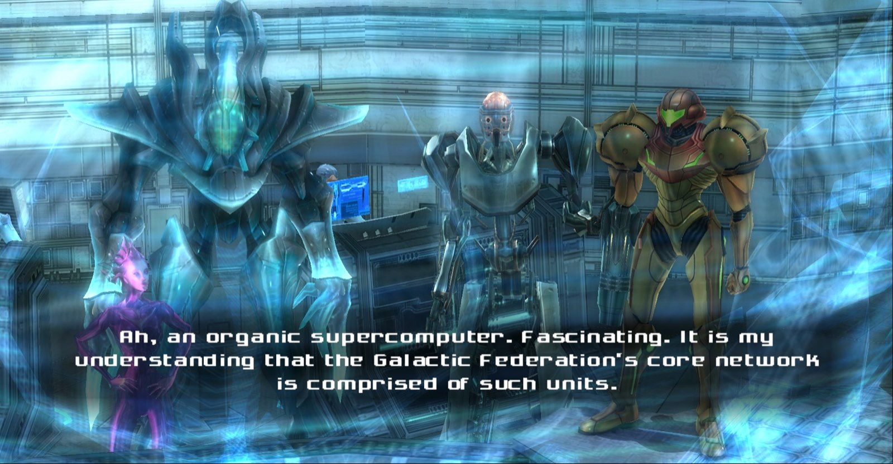 | 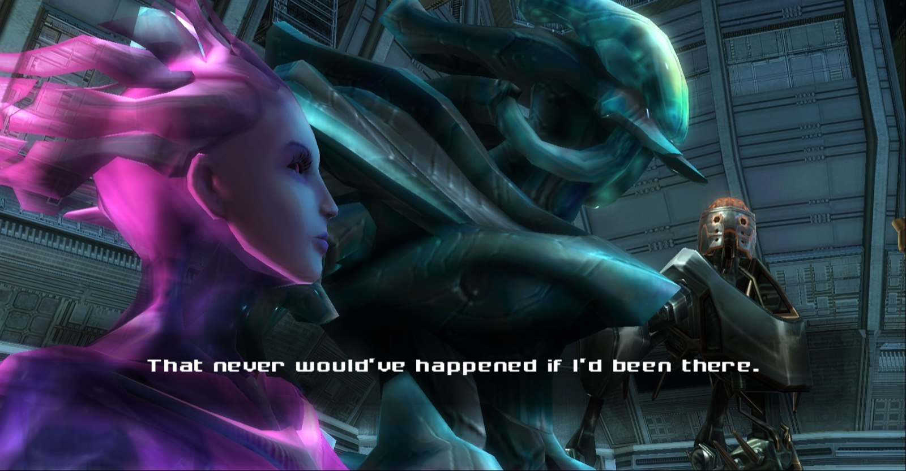 |
| Briefing on the Olympus: Ghor's machine metal, Rundas' crystal armour, Gandrayda's softer skin sheen and Samus' suit | Gandrayda and Ghor close up |
| 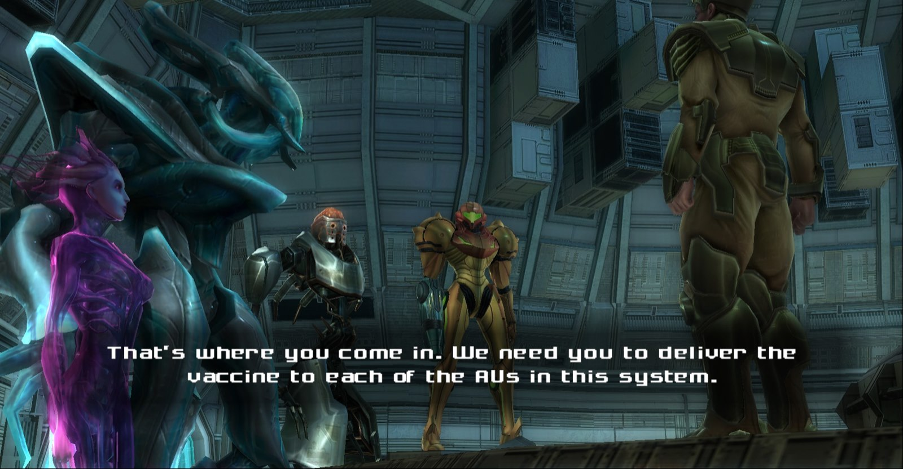 | 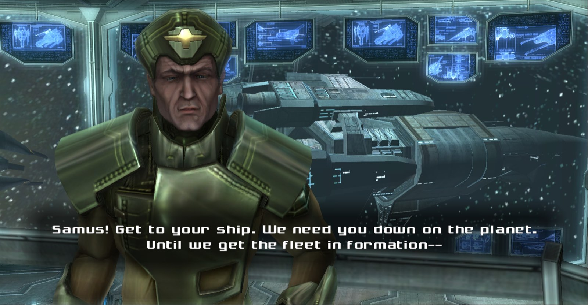 |
| The hunters and Admiral Dane (his skin is kept out of the metal material) | Dane with the Federation fleet: brushed-metal hulls |
| 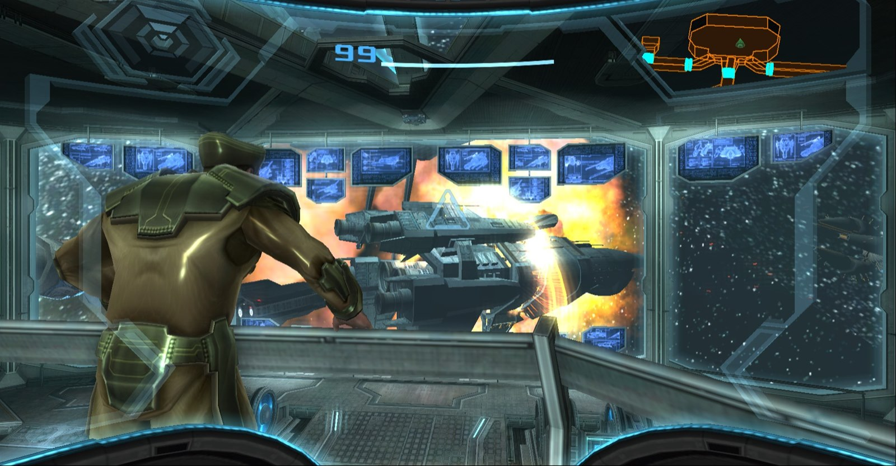 | 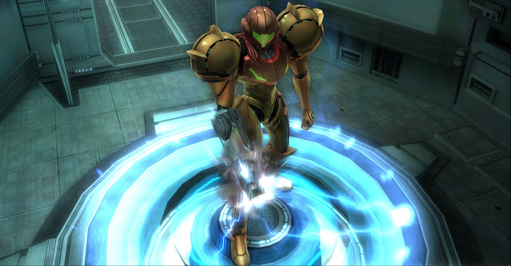 |
| The Olympus bridge during the pirate attack, through Samus' visor | Samus at a save station |
| 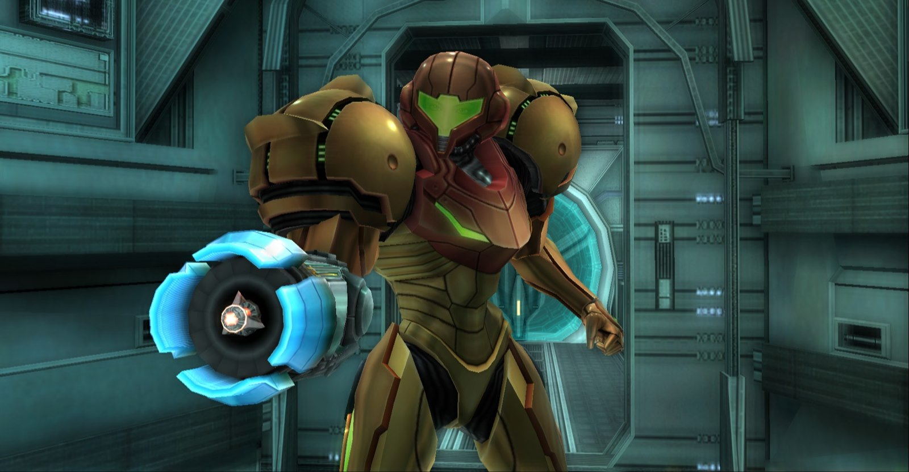 | 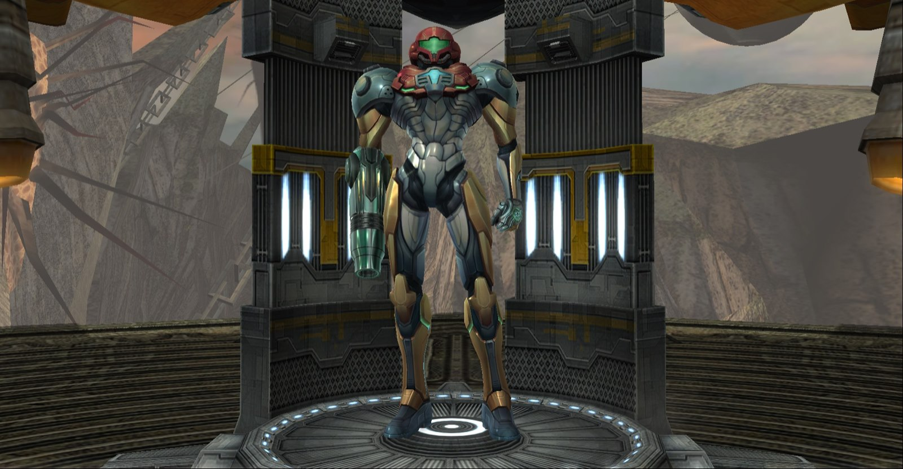 |
| The suit with the enhanced metal material | PED suit on Bryyo |
| 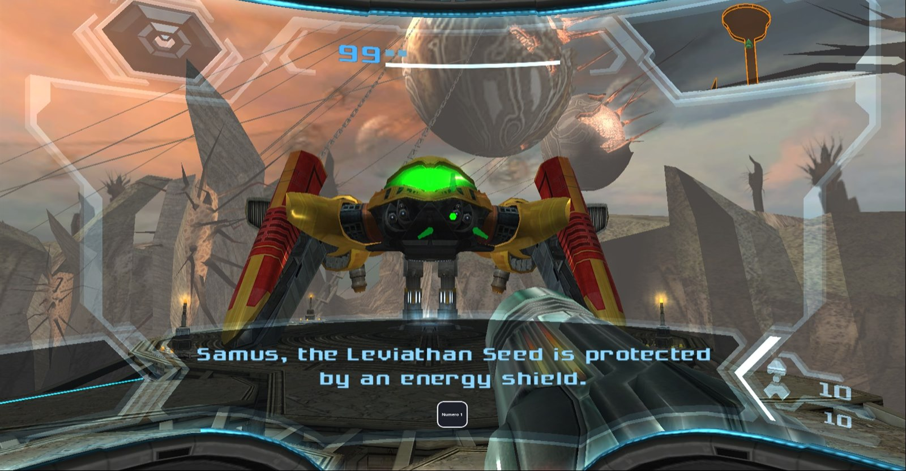 | 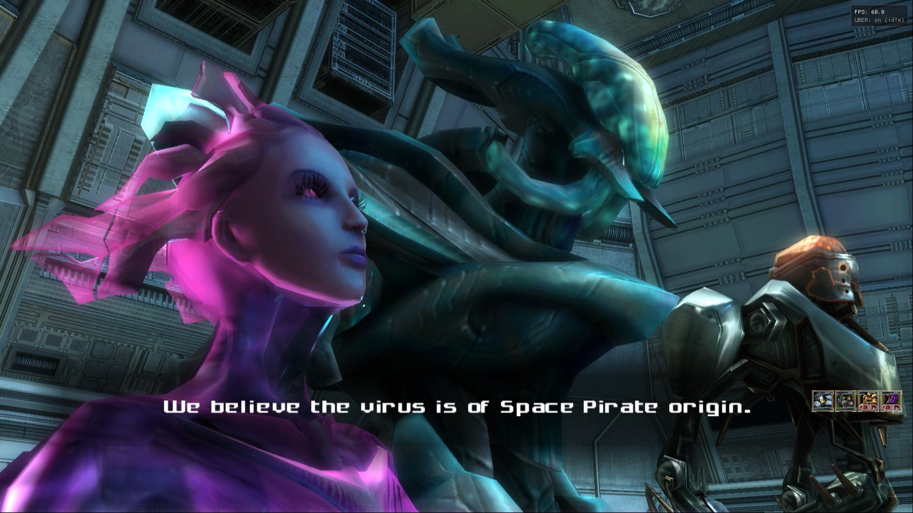 |
| Samus' gunship on Bryyo; the prompt shows your key instead of the Wii button | Gandrayda with her slightly improved material |
| 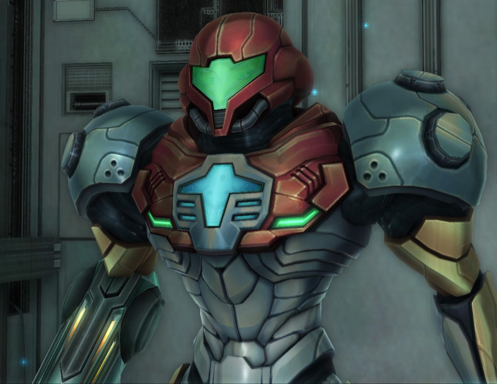 | 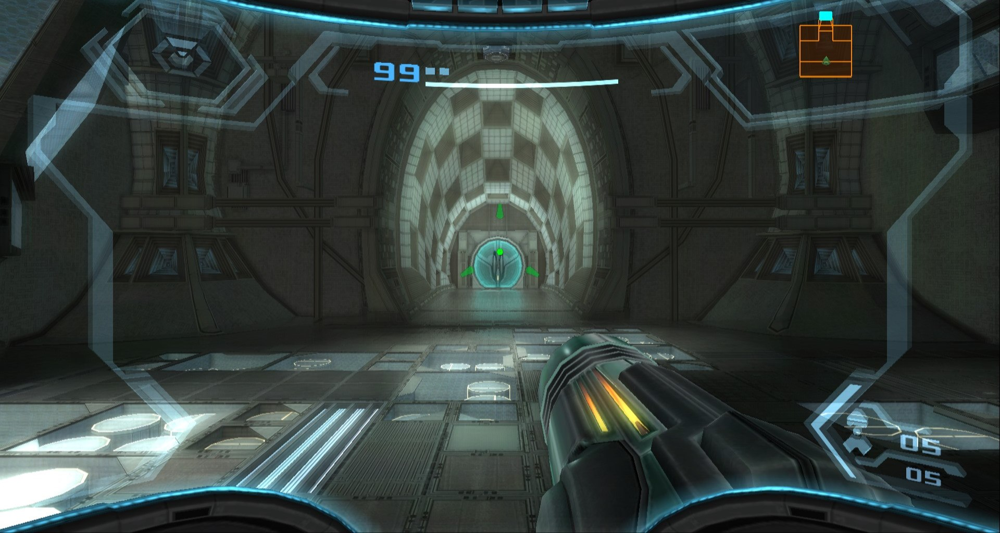 |
| Samus close up, with subtle ambient occlusion (SSAO), which I keep improving and optimizing | The same SSAO in a first-person view of a corridor |

## Work in progress

- **Performance:** with the ubershader, new materials no longer cause stutter, and on a newer PC the port held a stable
  60 FPS with no stutter. My own PC is older (4-core i7-4790 with DDR3), and there the heaviest scenes (many enemies or
  effects at once, areas loading in) can still take the game logic longer than a frame. I keep optimizing them, release
  after release. The game logic always runs at 60 Hz like the console, it is never sped up or slowed down.
- **Visuals:** I want to keep improving the game's materials (more surfaces with a proper metal, paint, crystal or
  skin response) and the new World lighting for walls and floors, always from the original textures, and each
  improvement can be switched off in F1.
- **Controllers:** real Wii Remote support with the IR pointer (see above).

---

## Requirements

| | Windows | Linux |
| --- | --- | --- |
| OS | Windows 10 or 11, 64-bit | x86_64 distribution with glibc 2.35 or newer (Ubuntu 22.04, Debian 12, Fedora 36 or later), X11 or Wayland |
| CPU | x86-64-v3 (Intel Haswell / 4th gen or newer, AMD Excavator / Zen or newer) | same |
| GPU | Direct3D 12 or Vulkan capable, up to date drivers | Vulkan driver, up to date |
| RAM | 8 GB with the Windows page file enabled for the first launch; 16 GB recommended | 8 GB with swap for the first launch; 16 GB recommended |
| Sound | (built in) | PipeWire, PulseAudio or ALSA |
| Game | Your own dump of *Metroid Prime 3: Corruption* (USA), game ID `RM3E01`, or of *Metroid Prime Trilogy* (USA), game ID `R3ME01` (its Metroid Prime 3 only), as `.iso` or `.rvz` (only these two are accepted: Dolphin converts a dump to either, right-click the game > *Convert File*) |

## Getting started

1. Download the latest `Corruption_3-PC-vX.Y.Z-win64.zip` from the [Releases](../../releases) page and unzip it anywhere.
2. Run **`Corruption_3 PC.exe`**. On the first start it asks for your disc image: pick the file in the dialog.
   The path is saved in `UserData/Config.toml` once the image opens, so you are asked only once (change it later in
   **F1 > Diagnostics**, with the dialog or by pasting the path). Two ways to skip the dialog entirely:
   - put your dump in a folder named **`game`** next to the executable (`game/Metroid Prime 3.rvz`); it is found by
     itself, or
   - start the executable with **`--iso "<path to the dump>"`**, or set the **`CORRUPTION3_ISO`** environment variable to
     that path. Useful for shortcuts, scripts and launchers; neither is written to `Config.toml`.
3. Pick your save slot with the mouse and click. **F1** opens the options at any time.

### Linux

1. Download the latest `Corruption_3-PC-vX.Y.Z-linux-x86_64.tar.gz` from the [Releases](../../releases) page and extract it
   anywhere (`tar -xzf Corruption_3-PC-vX.Y.Z-linux-x86_64.tar.gz`). Keep the folder together: it brings its own
   libpng, everything else is a system library.
2. Run **`./"Corruption_3 PC"`** from that folder. The disc image is chosen the same way as on Windows: the dialog on
   the first start, the `game` folder, or `--iso "/path/to/dump.rvz"`.
3. Everything else in this README applies too; read `Corruption_3 PC` where it says `Corruption_3 PC.exe`. On Linux
   the graphics API is Vulkan, MSAA goes up to 4x and ReShade is not included. `README - Linux.txt` in the archive has
   the details (RetroAchievements login storage, F12 if your desktop takes that key).

### Metroid Prime Trilogy (optional add-on)

To play the Metroid Prime 3 of *Metroid Prime Trilogy* (USA), also download the add-on from the **same release**:
`Corruption_3-PC-vX.Y.Z-Trilogy-addon-win64.zip` on Windows or `Corruption_3-PC-vX.Y.Z-Trilogy-addon-linux-x86_64.tar.gz`
on Linux, and extract it into the same folder, next to `Corruption_3 PC.exe` (on Linux:
`tar -xzf <add-on>.tar.gz -C <your folder> --strip-components=1`). It only adds two files,
`Corruption_3 Trilogy Menu` and `Corruption_3 Trilogy MP3` (`.exe` on Windows), which use the main folder's files,
settings and saves. Then start `Corruption_3 PC.exe` as usual and pick
your Trilogy disc image: the Trilogy menu opens, where your saves are, and it starts Metroid Prime 3. Metroid Prime and
Metroid Prime 2 are not part of the port.

- Both archives must be the **same version**. A Trilogy add-on of another version refuses to start and says which
  file to download.
- If you pick a Trilogy disc without the add-on, the disc dialog says what is missing and lets you choose another image.
- **F1 > Info** shows whether the add-on is installed.

**The first launch of a new install compiles the game's shaders in the background.** Measured on a 4-core i7-4790:
**about 17 minutes, with memory use temporarily reaching about 9 GB** (of 16 GB installed). That memory stays in use until
you close the game, so restart it once the compilation has finished. Later launches get ready in **about 7 seconds**.

Everything the port writes (settings, saves, logs, caches, bug reports) stays inside its own `UserData` folder next to the
executable. The disc image is only ever read, wherever it lives.

## Updating to a new version

Unzip the new release **over the same folder** and overwrite when asked. If you use the Trilogy add-on, unzip the new
add-on over the folder too, after the main archive (both must be the same version; the update notice reminds you).
The zips never contain `UserData`, so your saves, settings, key bindings and the remembered disc image path are kept. Nothing else is needed; only the shaders
that changed are compiled again on the next start.

## Controls

The port drives a virtual Wii Remote and Nunchuk. Every key can be remapped in **F1 > Controls**; the game's own button prompts show your keys instead of Wii buttons.

| Keyboard / mouse | Wii |
| --- | --- |
| Mouse | Aim. In first person the camera follows the mouse (mouse look) |
| Left click / Enter | A |
| Right click / Space | B |
| W A S D | Nunchuk stick |
| Shift | Z (lock on) |
| Ctrl | C (Morph Ball) |
| Arrow keys (middle click = down) | D-pad |
| 1 | + (pause / menu) |
| 2 | - (visor select) |
| Numpad 1, Numpad 2, H | 1, 2, HOME |
| E / Q (hold, release) | Push the remote forward / pull it back (levers, ship controls) |
| Z / X (or Numpad 7 / 8) | Twist the remote left / right |
| R / F | Flick the Nunchuk: grapple lasso throw / pull |
| T | Flick the remote up (Morph Ball spring jump) |
| G (hold), U/J, N/M, I/K | Shake both, tilt remote, twist Nunchuk, tilt Nunchuk |

Full table and gesture notes: [docs/controls.md](docs/controls.md).

### Gamepad

A gamepad works at the same time as the keyboard and drives the same virtual Wii Remote and Nunchuk. Every button can
be remapped in **F1 > Controls**, and the game's prompts show your gamepad's buttons while you use it.

| Gamepad (Xbox / PlayStation) | Wii |
| --- | --- |
| Left stick | Nunchuk stick |
| Right stick | Camera in first person; the pointer in menus, visor selection and while locked on |
| RT / R2 | A (fire) |
| A / Cross | B (jump) |
| LT / L2 | Z (lock on) |
| B / Circle | C (Morph Ball) |
| LB / L1 | - (visor select) |
| Menu / Options | + (pause) |
| D-pad; also X / Square for down | D-pad (down = missiles) |
| View / Create | 1 |
| Share or touchpad | 2 |
| Y / Triangle | Grapple Lasso throw (RB / R1 + Y / Triangle: pull) |
| Left stick click | Morph Ball spring jump |
| Right stick click | Shake |
| RB / R1 (hold) | Motion mode: the right stick twists, pushes and pulls the remote (levers, valves, ship controls) |

**One button for the Wii Remote's motion events.** A gamepad has no motion gestures to perform, so **RB / R1** stands in
for them. Hold it and the right stick twists, pushes and pulls the remote. The other movements are in the *With RB held*
column of **F1 > Controls**: RB + Y pulls the lasso, RB + D-pad up or down tilts the remote, RB + D-pad left or right
twists the Nunchuk, and RB + X or B tilts the Nunchuk. Everything else keeps working while you hold it, so you can still
move, fire and jump.

  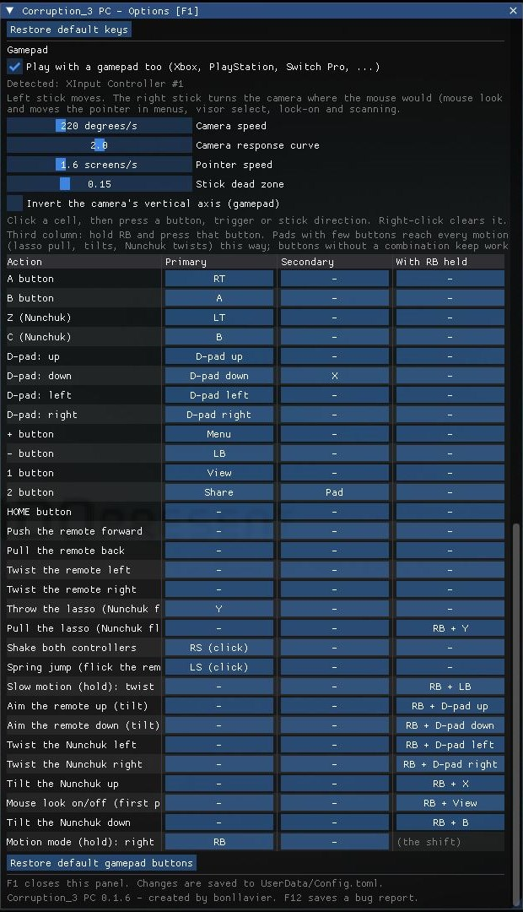 Controls, with the With RB held column" width="420">

### Aiming with the mouse: as little latency as possible

On the Wii the game smooths the pointer and the camera to hide the shake of a hand-held remote. A mouse has no shake,
so on PC those stages only add delay between moving the mouse and Samus aiming or firing. The port removes them (all
on by default, each can be switched off in F1):

- **No pointer smoothing**: the game filters the pointer adaptively; on slow, precise movements that filter added
  dozens of frames of lag, and about three frames on fast ones. The port hands the game the raw mouse position.
- **Mouse look without inertia**: in first person the camera follows the mouse directly. The game's vertical easing
  and its limit on how fast the view can tilt up or down are bypassed while you aim with the mouse (horizontal turning
  had no inertia to begin with). Optional smoothing exists in F1 > Controls and is off by default.
- **Mouse read at the last moment**: the position is read exactly when the game reads its controller, not from an
  event that may be one frame old.
- **One image in the presentation queue** instead of up to three: the picture you see is the newest one rendered.
  **Borderless fullscreen** also skips the Windows compositor.

Measured in game, from a mouse movement to the frame that shows it: **about 39 ms before, about 31-32 ms now**. That
figure does not include the removed pointer smoothing or the images that used to wait in the presentation queue, so
the real difference you feel is larger. The rest is the game itself: it reads the controller at the start of a frame
and shows the result about one frame later, exactly like the console, at 60 Hz.

### Mouse too fast or too twitchy? Sensitivity and smoothing

If aiming feels too sensitive, or the view jumps when you only meant to correct your aim a little, adjust these in
**F1 > Controls** (they apply right away, so you can try them while you aim):

- **Mouse sensitivity**: how far the view turns for each pixel the mouse moves, from 0.02 to 1.00 degrees per pixel
  (default 0.20). Lower it to turn less per movement: precise shots get easier, and big turns need a longer swipe.
- **Mouse smoothing**: spreads each movement over a few frames, from 0 (none) to 0.90 (default 0.01, almost none).
  A little smoothing, for example 0.2 to 0.4, takes the jitter out of small corrections and makes tracking a target
  calmer. The higher the value, the softer and slightly more delayed the view feels, so raise it only until it is
  comfortable.
- **Invert the mouse's vertical axis**, if you prefer moving the mouse forward to look down.

Also worth knowing:

- The game has its own sensitivity setting in its options menu (Basic, Standard or Advanced), which sets how fast the
  view may turn at most. If fast swipes feel capped, choose a higher level there; if everything feels too fast, lower the port's *Mouse sensitivity* first.
- A lower DPI on the mouse itself (in its software or with its DPI button) also makes small movements finer.
- Mouse look only works while you aim in first person without a lock-on. In menus, on the map, in Morph Ball and in
  cut-scenes the mouse moves the pointer as usual, and those sliders do not apply there.

### Hotkeys

| Key | Action |
| --- | --- |
| F1 | Port options: video, controls, audio, performance, effects, materials, info, diagnostics |
| F2 | RetroAchievements window: sign in, your account, the achievement list (casual mode) |
| F3 | **Photo mode**: freezes the game; the right arrow advances one frame |
| F10 | Renderer bar (resolution, display mode, Wii Remote pairing, audio) |
| F12 | **Create a bug report** (screenshot + log + settings, zipped; the file name carries the version) |
| F11 | **Screenshot**: the game picture with the image effects, saved as JPEG in `UserData/Screenshots` (`Corruption3PC_v<version>_<build>_<date>_<time>.jpg`). For now the FPS counter and the port's notices can end up in the picture; untick F1 > Video > *Show FPS* for a clean shot |
| F6 | Virtual Wii Remote motion panel |
| Esc | Exit prompt |

## RetroAchievements

**Earn real [RetroAchievements](https://retroachievements.org) directly in the port, with no emulator or extra tool.**
The port runs the Wii game's own code on the same memory layout, so it can read the conditions written for this game.
Achievements are detected while you play and recorded on your account. Press **F2** to open its window.

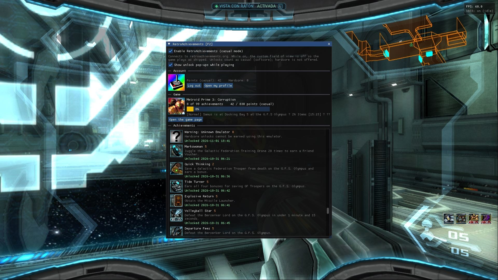

- **The game's set:** 99 achievements worth 830 points at the time of writing, each with its badge, description, and
  unlock date or progress bar.
- **Your account in the game:** log in or create an account, see your avatar and points, and open your profile or the
  game's page. Your session is remembered between launches.
- **Your progress at a glance:** achievements and points earned, a completion bar, and a live line with where you are in
  the game.
- **Pop-ups in the style of Samus' visor:** each unlock slides in with its badge, title, description and points. You can
  turn them off.
- **Indicators while you play:** progress towards an achievement, and active challenges as badges with a pulsing frame.
- **Connection notices:** the port tells you if the connection to the server is lost or comes back.
- **Your credentials stay protected:** the password is never stored. The session token is encrypted by Windows for your
  user and is never included in F12 bug reports.
- **Built to leave the game running smoothly:** network requests, the disc check and badge downloads run on separate
  threads.

**Current limits:**

- Unlocks count as **casual (softcore)**; hardcore is not offered.
- Leaderboards are not supported yet.
- While RetroAchievements is on, the custom field of view is turned off so the game plays as shipped.
- So far I have unlocked 8 of the 99, at the start of the game. If a later achievement does not trigger, please report it
  in [Discussions](../../discussions) and say where you were.

## Version and updates

**F1 > Info** shows the exact build you are running (version, build date), the paths in use and whether a newer
release exists: at startup the port sends one request to `api.github.com` for the latest release and shows a green
notice for a few seconds when there is a newer one (turn it off in that tab or with `check_updates = false`).
`Check for updates.ps1` in the game folder does the same from PowerShell. Every F12 report also records the version
in its file name (`report_<date>_v0.1.0.zip`) and in `system.txt`, so please always report with the latest build.

## Reporting bugs

Press **F12** when something looks wrong. The port writes `UserData/Reports/report_<date>.zip` with a screenshot, the
console log of that session, your settings, your save and a system summary, then opens the folder for you. Post the zip in
[Discussions](../../discussions) (*Bug reports*) and say **where in the game you were** (planet, room, what you were doing).

If the game closes with an error dialog, the dialog names the `UserData/Logs/...` folder of that run. Zip that folder and attach it.
Nothing personal is collected: you can open every file in the zip before posting it. See [docs/troubleshooting.md](docs/troubleshooting.md).

## Options worth knowing (F1)

- **Video**: aspect ratio (16:9, 4:3, or ultrawide: match the monitor, 21:9 or 32:9, which widens the view to the sides and keeps the HUD in the 16:9 area; pre-rendered videos stay 16:9), internal resolution (monitor native by default), MSAA 2x/4x/8x, anisotropic filtering, first-person field of view (not available while RetroAchievements is on), per-pixel lighting, enhanced metal (modern metal material on the suit, armour and machinery; skin is left alone; on by default), enhanced materials (the same treatment for identified surfaces such as the starship hulls; on by default), console copy filter (the Wii's vertical blur, off by default), native 120 FPS and frame interpolation to 120/180 Hz (both experimental and off by default, see [High frame rates](#high-frame-rates-native-120-fps-and-interpolated-both-experimental)), custom textures and texture dumping (see [Custom textures](#custom-textures-and-hd-texture-packs)), panel size (makes the F1, F2 and other port panels larger, up to 400 %; *Automatic* follows the window height, 200 % at 4K).
- **Controls**: key and gamepad bindings, mouse look sensitivity and smoothing (since v0.1.8 mouse look turns up and down ±80 degrees, as far as the Wii Remote reaches), keyboard icons in game prompts, hide cursor, always-full Wii Remote battery.
- **Audio**: volume, stereo / Pro Logic II / mono, high-quality resampler.
- **Language**: the game's text in English, Spanish, French, German or Italian, from the USA disc (restart to apply).
  See [Game language](#game-language-english-spanish-french-german-or-italian).
- **Performance**: GPU thread, disc reads on their own thread, texture decoding on several cores, shader waiting policy, and the experimental *ubershader* (see below). The game logic always runs at 60 Hz, like the console.
- **Effects** and **Materials**: see [Image effects](#image-effects-f1--effects). Materials has the options for Samus out of the suit, the gunship and Gandrayda's frost.

## High frame rates: native 120 FPS and interpolated (both experimental)

There are two different ways to go above 60 frames per second, both in **F1 > Video** and both off by default. Use one
or the other, never both: native 120 turns the interpolated one off while it runs.

| | Native 120 FPS | Frame rate above 60 (interpolated) |
| --- | --- | --- |
| What it does | The game itself runs and draws 120 real frames per second, at the console's speed | The game stays at 59.94 frames per second; extra in-between images are shown |
| Motion and response | Real 120: quicker response to the mouse | Smoother picture, a little more input latency |
| Main cost | CPU (twice the game's work), and twice the frames to draw | GPU (every extra image) |
| RetroAchievements | Off while it runs | Available |
| Applies | At the next start | Right away |
| Known problems | Some menu and helmet (HUD) animations and icons run twice as fast; other per-frame effects may too | Visual errors in some scenes |

**Native 120** (*Native 120 frames per second (experimental, applies at restart)*, `[video] native_120fps`) needs a
120 Hz monitor and a PC that holds about 120 frames. When the PC cannot keep up, the game keeps its speed but motion
becomes uneven. Some parts of the game advance once per drawn frame instead of by time, so they run twice as fast at
120: so far some menu and helmet animations and icons. Expect other unwanted results as well. **This is the mode that
will keep being improved**: an F12 report of anything that runs too fast or looks wrong at native 120, saying where
it happened, helps the most.

**Interpolated** (*Frame rate above 60 (interpolated)*) is for PCs that cannot hold native 120: the game logic is
untouched and only the presentation inserts images, at the cost of more GPU and some latency. V-Sync is not needed
with native 120 (frames already follow the monitor) and only adds latency.

## Game language: English, Spanish, French, German or Italian

**You do not need a PAL (European) disc to play in another language.** The USA discs, *Metroid Prime 3: Corruption*
and *Metroid Prime Trilogy*, already contain the game's text in English, Spanish, French, German and Italian. On a
USA Wii the game only ever shows English; the port lets you choose. It works the same with the Trilogy add-on: the
Trilogy menu and its Metroid Prime 3 follow the same setting.

   Language: choosing the game language" width="620">

1. Press **F1** and open the **Language** tab.
2. Choose the language in **Game language**: *English*, *Español*, *Français*, *Deutsch* or *Italiano*. It is saved
   right away (`[prime] language` in `UserData/Config.toml`).
3. **Close the game and start it again.** The language is read when the game starts: the tab shows the language in use
   and reminds you to restart after a change.

It covers the menus, messages, the HUD, scans and the logbook. Your save is not affected: the same save works in every
language. A few system notices (the disc and Nunchuk warnings) stay in English.

### Improved translations

The translated text of the USA discs has mistakes of its own, which the port corrects as the game shows it. Your disc
is never modified, and no European disc is needed or read.

- **Spanish:** reviewed in full against the English text. Fixed: phrases that had been left in English, hints and scans
  that said the opposite of the English one, scans showing another scan's text, entries with the wrong title, and
  about 150 typos. Names are unified with the Spanish revised by Nintendo for Trilogy (for example *Visor de Rayos X*,
  *Visor de Órdenes* and *Omega Ridley*), and a few expressions were adapted so they read naturally.
- **German, French and Italian:** phrases left in English (in Italian, for example, two logbook entries and the save
  notice at the end of the game), around 200 typos across the three languages, wrong button icons and a missing text
  tag.
- **Metroid Prime Trilogy (USA):** its menu was almost entirely in English in the other four languages (buttons,
  galleries, the soundtrack titles, save slots, parental control); it is now translated. So are 13 scans that only
  exist in Trilogy and a few notices in its Metroid Prime 3.
- **Motion prompts** that describe a Wii Remote or Nunchuk gesture name your key or gamepad button instead, in every
  language, with keyboard and mouse or a gamepad.

If you find a mistake that is still there, press F12 where you see it and post the report, saying what it should say.

## Lower-end PCs: what to turn off first

The image effects the port adds on top of the original game cost GPU time, sometimes as much as the game itself. On
the maintainer's PC, with GPU timing on (1 November 2026), a frame took about 5 ms of GPU on average: about 2.2 ms for
the game and about 2.5 ms for the added effects; in the heaviest fight tested, the effects reached 9.5 ms while the
game stayed under 5 ms. If your frame rate drops below 60, or your PC runs hot or loud, turn these off, in this order,
and check the FPS counter (F1 > Video > Show FPS) after each step. Everything applies right away:

1. **F1 > Effects > Ambient occlusion (SSAO)**: off.
2. **F1 > Effects > World lighting (experimental)**: turn off *Floor reflections (SSR)*, *Wall reflections*,
   *Environment material*, *Borrowed lights*, *Soft character shadows* and *Material in rooms with live lights*. The
   walls and floors then show the game's own baked lighting, as on the Wii.
3. **F1 > Video**: a lower *Internal resolution* saves the most on a weak GPU; keep *Antialiasing* off and lower
   *Anisotropic filtering*. *Per-pixel lighting*, *Enhanced metal* and *Enhanced materials* can go off too: the
   lighting and metal then look as in the original.
4. Keep the experimental options off: *Native 120 frames per second* (twice the game's work, mostly CPU), *Frame rate
   above 60 (interpolated)* (more GPU for every extra image),
   *Modern lighting* and *Light shafts* (all off by default).

With all of the above off you get the original look of the game at your monitor's resolution, which needs far less
from the GPU. If the FPS still drop with everything off, the limit is usually the CPU (the game's own logic): press
F12 there and post the report, saying where you were. v0.1.8 cut the game thread's work by about 8 % with the
original Metroid Prime 3: Corruption disc (see the [changelog](CHANGELOG.md); the Trilogy add-on gets it in v0.1.9),
so update first if you are on an older version.

## Please read: shaders and the cache

The Wii draws with a fixed-function GPU whose state (texture stages, blending, lighting, fog...) the game changes
thousands of times per frame. On a PC each distinct combination has to become a real shader program, compiled by your
graphics driver for *your* GPU. The port cannot know every combination in advance, so:

- **The first time a material appears on your PC, its shader is compiled in the background**, for example when you enter
  a new room, meet a new enemy or fire a new weapon for the first time. Until it is ready the ubershader draws that
  material, so the game keeps running (see below). The port ships a seed of every combination seen so far (thousands of
  them) and compiles it in the background at startup, which is why the first launch takes minutes and temporarily uses
  a lot of memory (see [Getting started](#getting-started)); areas nobody has played yet still compile on sight.
- **Compiled shaders are kept in `UserData/Cache`.** The next visit to the same place, and the next launch, do not
  compile again. Do not delete that folder unless troubleshooting.
- **What to report:** if you see stutter or constantly low FPS, post it with the area name and your CPU and GPU.
- **How you can make it better for everyone:** after playing new areas, your `UserData/Cache/pipeline_cache.db`
  contains the recipes (not shaders, not game data, a few MB) of everything you rendered. Attaching it to a Discussions
  post lets the next release ship them pre-seeded, so other players never compile them.
- The option *F1 > Performance > "Experimental: do not wait for new shaders"* (on by default) keeps the frame rate
  up during compilation by skipping a draw for a fraction of a second instead of freezing the whole game; if you see a
  piece of a room pop in late, that is this option doing its job.
- *F1 > Performance > "Ubershader while shaders compile"* (on by default) goes one step further: while
  a material's shader compiles, it is drawn with a generic shader that reads the material from memory, so nothing is
  skipped and nothing waits. Compiled shaders and the cache always have priority; the ubershader only covers the gap.
  It adds about 100 MB to the shader cache and a couple of seconds to start-up, and costs some GPU time during those
  few frames.

## Image effects (F1 > Effects)

Two ways to tune the look:

- **Aurora effects** (built in, apply instantly, cost little): ambient occlusion from the depth buffer (**on by
  default**: soft contact shading in corners and where objects meet, applied to the 3D world only, never to the visor
  or HUD, and never to Samus' face or her body out of the suit; needs MSAA off; *Reset SSAO* restores the tuned defaults), extra bloom/glow, CAS sharpening, FXAA, and colour
  grading (brightness, contrast, saturation, gamma, temperature, vignette), which are off by default. The game's own
  bloom and lighting are untouched. SSAO quality defaults to 8 samples.
- **World lighting** (experimental, each option on its own): an environment material and borrowed lights for walls and
  floors with baked light, **floor reflections** (on at strength 0.70) and **wall reflections** on very smooth walls such
  as polished panels (on at strength 0.80, in their own section; low to medium cost; Samus herself is never reflected).
  Reflections only show what is on screen. Light shafts, area-coloured reflections and linear light blending are off by
  default.
- **ReShade** (bundled in the `reshade` folder, BSD licence): tick *Load ReShade at startup* in F1 > Effects and restart.
  In game, **Home** opens the ReShade menu with every effect and parameter, **End** toggles all effects, **Print Screen**
  saves a screenshot. ReShade effects pause automatically in menus, the map, videos and while a port panel (F1, F10,
  F6) is open, so they never touch those screens. A starter preset enables CAS and SMAA; the bundled set also has FXAA, LumaSharpen, MagicBloom,
  AmbientLight, Vibrance, Tonemap, Curves, Levels, LiftGammaGain, Vignette and LUT. Direct3D 12 only.

Effects are post-processing: they cannot add texture detail, and heavy ReShade shaders cost frame time. If you report a
visual glitch, say whether any effect or ReShade was active (the F12 report records your settings).

## Custom textures and HD texture packs

**HD texture packs made for Dolphin work in the port without conversion.** The port reads replacement textures with
Dolphin's file names (`tex1_<width>x<height>_<hash>_<format>.png` or `.dds`), so a pack for *Metroid Prime 3* or
*Metroid Prime Trilogy* can be used as it is ([confirmed by a player](https://github.com/bonllavier/Corruption_3-PC/issues/14)).
This project does not provide or link packs.

1. Close the game.
2. Copy the pack's files (usually the contents of its `Load/Textures/RM3E01` or `R3ME01` folder; subfolders are
   fine) into `UserData/texture_replacements/`, next to the port's own folders (`strap_screen`, and
   `keyboard_icons` or `variants` if you use key or gamepad icons), which must stay.
3. Start the game.

Good to know:

- The first start with a big pack, and the first visit to each area, are slower: each image is read and decoded the
  first time its texture appears. There is no preloading or progress bar yet. **DDS packs (BC7/BC1/BC3) load much
  faster than PNG** and use less video memory.
- A pack only replaces the textures whose hash matches your disc (Corruption `RM3E01` or Trilogy `R3ME01`); the rest
  stay original.
- In v0.1.7 custom textures are active whether or not *F1 > Video > Custom textures* is ticked. To play without a
  pack, move its folder out of `texture_replacements`.
- *F1 > Video > Dump game textures* (with *Custom textures* ticked, restart) writes every texture without a replacement
  to `UserData/Cache/texture_dumps`, already named the way its replacement must be, for checking a pack or making your own.

Full guide: supported formats, mipmaps, dumping, load times and problems in
[docs/custom_textures.md](docs/custom_textures.md).

## Antivirus warnings

Every release is scanned with VirusTotal, and the public reports are linked in its release notes. Windows SmartScreen
may also warn you, because the executable is not signed and each release is a new file.

**v0.1.8:** no engine flags anything. That covers the four downloads (57 to 66 engines each), the three Windows
executables (66 or 67 engines each, Trapmine included) and the three Linux executables (63 engines each).

**v0.1.7:** none of the 61 to 66 engines flags any of the four downloads (both Windows zips and both Linux archives),
and none of the 54 that analysed the Linux executable flags it. On Windows, 1 of the 69 or 70 engines that analysed
`Corruption_3 PC.exe`, `Corruption_3 Trilogy Menu.exe` and `Corruption_3 Trilogy MP3.exe` flags each of them: **Trapmine**, with the label
`suspicious.low.ml.score`, its lowest level. The other 68, including Kaspersky, Bitdefender, Malwarebytes, Microsoft and
ESET, report nothing. I consider it a false positive, although a scan alone cannot prove that. These are my reasons:

- **It is a machine-learning score, not a malware signature.** The label names no malware family and no behaviour.
  Trapmine does not publish what triggers it.
- **Trapmine has flagged this port before.** Versions before v0.1.5 and v0.1.6 got `malicious.moderate.ml.score`,
  v0.1.5 and now v0.1.7 the lower `suspicious.low`. In [this r/antivirus thread](https://www.reddit.com/r/antivirus/comments/15zfn7x/maliciousmoderatemlscore/)
  about the same label, a game developer reports that Trapmine flags their two games as well, and other users advise
  paying more attention when major vendors agree. Those are personal experiences, not an official verdict.
- **The executable is the kind of file such a model may distrust.** It is about 160 MB, unsigned, seen by VirusTotal for the
  first time on release day, and mostly PowerPC code machine-translated to x86-64. This is my best guess, not a confirmed
  cause.

What the port itself does: it reads your disc image without modifying it and keeps what it writes in `UserData`. It uses
the internet for two features: the update check (`api.github.com`, can be turned off) and RetroAchievements (only if you
turn it on). The runtime also contains the Wii's own network functions, as part of the system it reproduces.

**Check it yourself:** download only from this repository's [Releases](../../releases), compare the zip with the SHA-256
in the release notes, and open the VirusTotal reports linked there. You never need to turn off your antivirus for this
project. If you are not comfortable running it, do not run it. If another engine or your own antivirus flags it, please
post the name in [Discussions](../../discussions).

## Known issues

- Experimental texture upscaling (Super-xBR) can paint some polygons magenta; it is off by default.
- *F1 > Performance > "Expand draws on the decoder thread"* is off by default. Turning it on breaks the lava surface in
  Bryyo (seams between its patches when ripples appear), so leave it off.
- A real Wii Remote cannot aim yet (no IR pointer), so it is not playable; use keyboard and mouse or a gamepad.
- Only the USA discs are supported: *Metroid Prime 3: Corruption* (RM3E01, revision 0) and *Metroid Prime Trilogy*
  (R3ME01), from which only Metroid Prime 3 runs. Choosing Metroid Prime or Metroid Prime 2 in the Trilogy menu shows
  a notice and returns to the menu. RetroAchievements are not available with the Trilogy disc.

## Legal

This is a non-commercial fan project with no affiliation to Nintendo or Retro Studios. *Metroid* and *Metroid Prime*
are trademarks of Nintendo.

- The release contains **no game assets**: no textures, models, audio, videos, text or levels. All of that is read at
  run time from the disc image you dump from your own copy of the game, which is never modified.
- The executable contains the game's **program logic translated to native code** (static recompilation), the way other
  recompilation projects work. It is unusable without the original disc. If you do not own the game, do not download this.
- Do not ask for, offer or link disc images anywhere in this project. Such posts are removed.

The port is built on [WiiCompiled](https://github.com/WiiCompiled) and its Aurora renderer and is licensed under the
[GNU GPL v3](LICENSE). Third-party components and their licenses are listed in [THIRD-PARTY-NOTICES.md](THIRD-PARTY-NOTICES.md).

## Credits

- **bonllavier**: port creator, Metroid Prime 3 runtime hooks, keyboard/mouse mode, PC options.
- WiiCompiled authors: static recompilation runtime and Aurora (GX on WebGPU/Dawn).
- nod (disc image reader), Dawn, SDL3, Dear ImGui, Super-xBR by Hyllian, and everyone in THIRD-PARTY-NOTICES.md.
