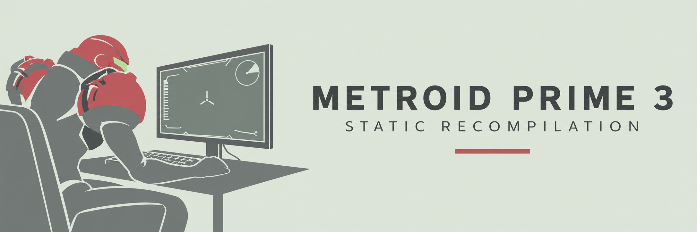
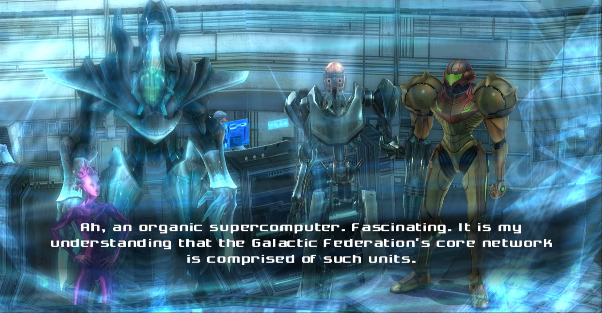
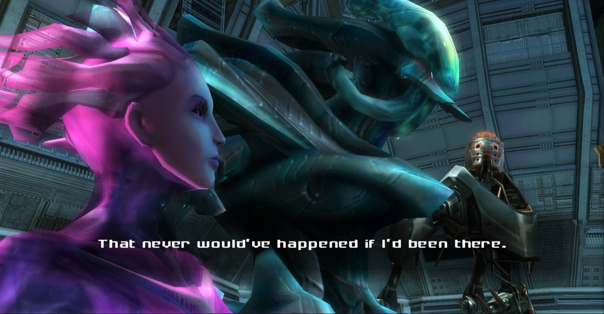
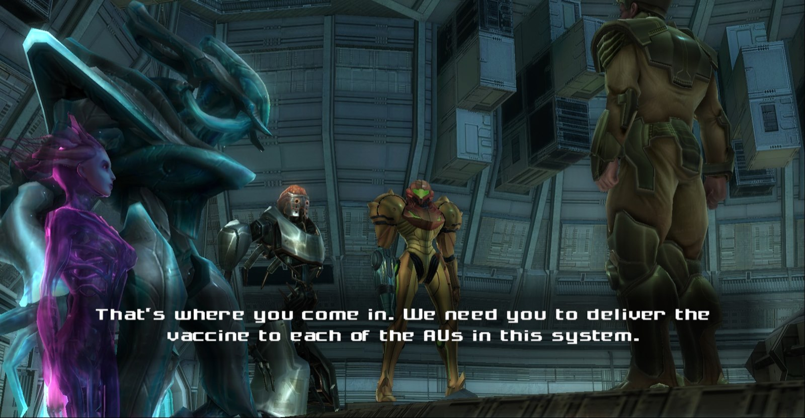
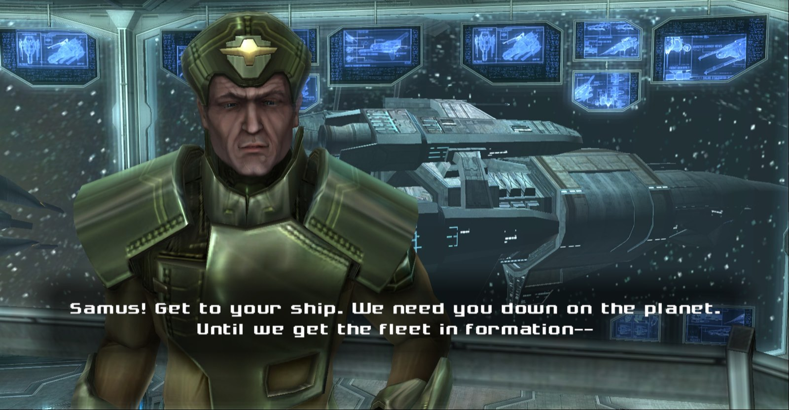
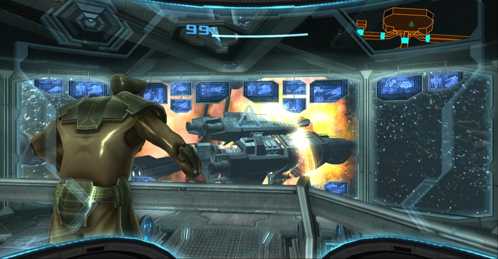
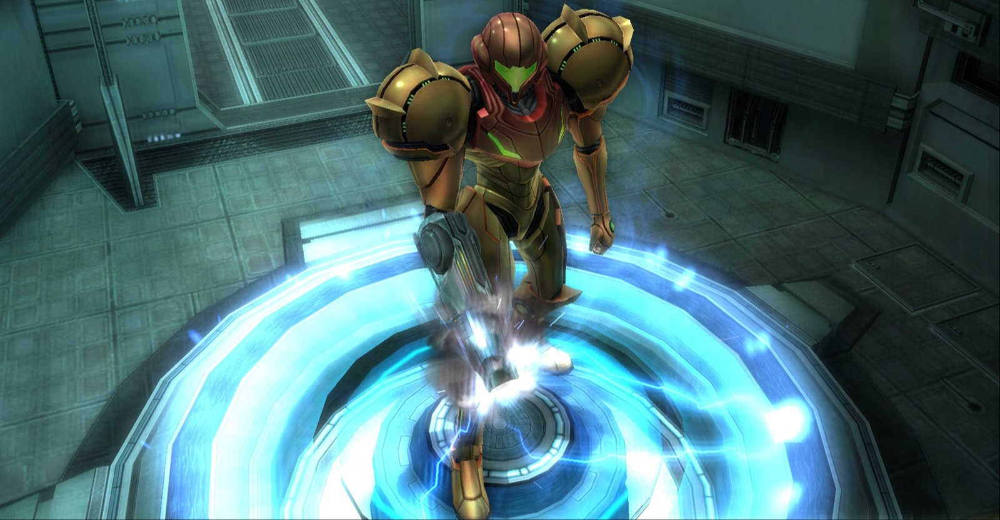
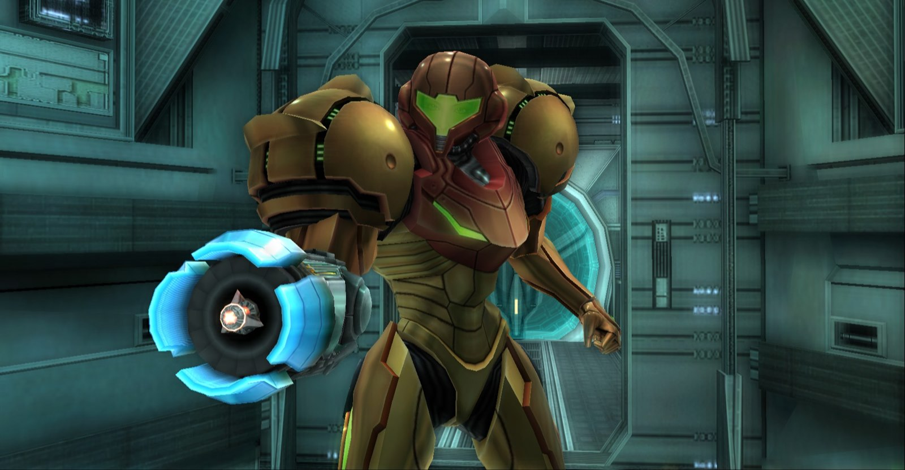
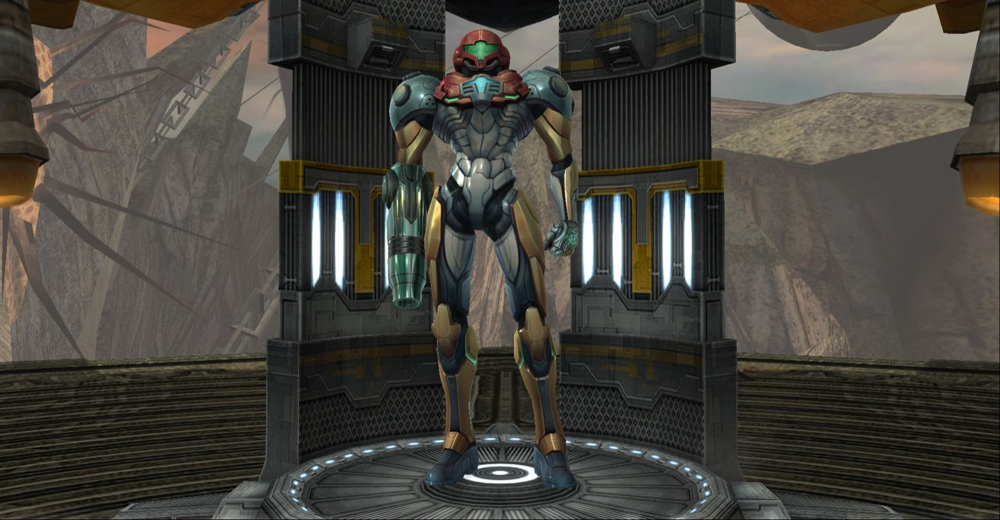
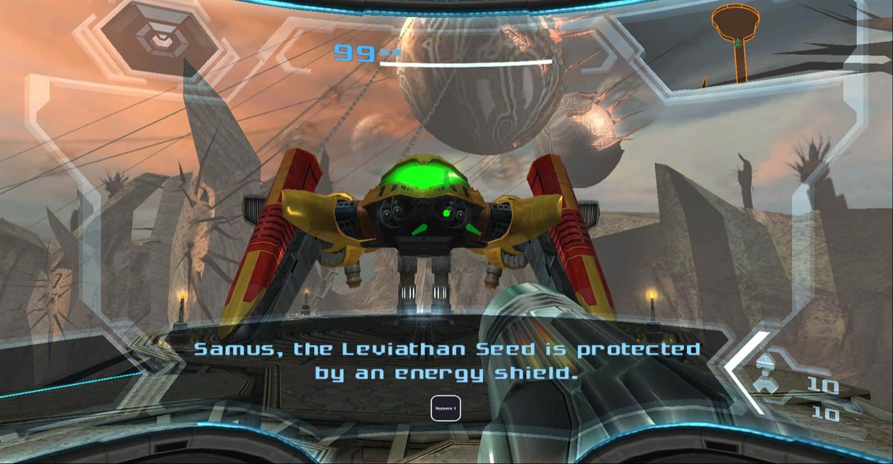

  

# Corruption_3 PC

A native Windows port of **Metroid Prime 3: Corruption** (Wii, USA), created by **bonllavier**.
The game's program code runs recompiled on your PC: no emulator, no virtual machine. You play with keyboard and mouse
or a gamepad, at your monitor's resolution, with per-pixel lighting, enhanced materials, ambient occlusion, floor and
wall reflections, anisotropic filtering and MSAA on top of the original look.

> **Controllers:** the port is played with **keyboard and mouse** or a **gamepad** (Xbox, PlayStation, Switch Pro and
> similar). A **real Wii Remote is not playable yet**: the port can read its buttons, motion and the Nunchuk over
> Bluetooth, but not the IR pointer, and Prime 3 needs the pointer to aim and turn. Proper Wii Remote support (pointer
> and sensor bar) should come later.

> ## ⚠️ Testing phase: testers wanted
>
> **This release is a test build, not a finished port.** The game boots, loads saves and the start of the campaign
> (G.F.S. Olympus, Norion, Bryyo up to the fight with Rundas) plays at or near 60 FPS; most of the Wii Remote and Nunchuk
> gestures are already mapped to keys and to the gamepad.
> Everything after that has not been played end to end, so expect missing textures, crashes, soft-locks and untested
> gestures. I need people to play it and tell me where it breaks.
>
> **How to help:** play, and when something goes wrong press **F12** in game. The port writes a small zip with a
> screenshot, the session log and your settings. Post it in **[Discussions](../../discussions)** (category *Bug reports*)
> together with **where you were in the game**. That one detail lets me go there and reproduce it. Performance problems
> only need the area name. Thank you!

**No game assets are included.** You need your own dump of the disc. See [Legal](#legal).

**Antivirus:** VirusTotal shows one machine-learning detection on the v0.1.6 executable. See
[Antivirus warnings](#antivirus-warnings).

## Gameplay video

*Metroid Prime 3 PC port - static recompilation - beta 0.1.5*: gameplay with keyboard and mouse. Click the image to
watch it on YouTube.

## Screenshots

Taken in game with **F11** (v0.1.5, 1080p, per-pixel lighting, enhanced metal and enhanced materials, ambient
occlusion on). No texture was replaced or upscaled: the materials are built from the game's own textures.

| | |
| --- | --- |
|  |  |
| Briefing on the Olympus: Ghor's machine metal, Rundas' crystal armour, Gandrayda's softer skin sheen and Samus' suit | Gandrayda and Ghor close up |
|  |  |
| The hunters and Admiral Dane (his skin is kept out of the metal material) | Dane with the Federation fleet: brushed-metal hulls |
|  |  |
| The Olympus bridge during the pirate attack, through Samus' visor | Samus at a save station |
|  |  |
| The suit with the enhanced metal material | PED suit on Bryyo |
|  | |
| Samus' gunship on Bryyo; the prompt shows your key instead of the Wii button | |

## Work in progress

- **Performance:** most of the game runs at 60 FPS, but there are still **stutters**: the first time a new material
  appears its shader has to be compiled, and some heavy scenes (many enemies or effects at once, areas loading in)
  take the game logic longer than a frame. I keep working on both, release after release; the goal is a steady 60 FPS
  everywhere. The game logic always runs at 60 Hz like the console, it is never sped up or slowed down.
- **Visuals:** I want to keep improving the game's materials (more surfaces with a proper metal, paint, crystal or
  skin response) and the new World lighting for walls and floors, always from the original textures, and each
  improvement can be switched off in F1.
- **Controllers:** real Wii Remote support with the IR pointer (see above).

---

## Requirements

| | Minimum |
| --- | --- |
| OS | Windows 10 or 11, 64-bit |
| CPU | x86-64-v3 (Intel Haswell / 4th gen or newer, AMD Excavator / Zen or newer) |
| GPU | Direct3D 12 or Vulkan capable, up to date drivers |
| RAM | 8 GB with the Windows page file enabled for the first launch; 16 GB recommended |
| Game | Your own dump of *Metroid Prime 3: Corruption* (USA), game ID `RM3E01`, as `.iso`, `.rvz`, `.wbfs`, `.gcz`, `.wia` or `.ciso` |

## Getting started

1. Download the latest `Corruption_3-PC-vX.Y.Z-win64.zip` from the [Releases](../../releases) page and unzip it anywhere.
2. Run **`Corruption_3 PC.exe`**. On the first start it asks for your disc image: pick the file in the dialog.
   The path is saved in `UserData/Config.toml`, so you are asked only once (change it later in **F1 > Diagnostics > Select disc image**).
3. Pick your save slot with the mouse and click. **F1** opens the options at any time.

**The first launch of a new install compiles the game's shaders in the background.** Measured on a 4-core i7-4790:
**about 17 minutes, with memory use temporarily reaching about 9 GB** (of 16 GB installed). That memory stays in use until
you close the game, so restart it once the compilation has finished. Later launches get ready in **about 7 seconds**.

Everything the port writes (settings, saves, logs, caches, bug reports) stays inside its own `UserData` folder next to the
executable. The disc image is only ever read, wherever it lives.

## Updating to a new version

Unzip the new release **over the same folder** and overwrite when asked. The zip never contains `UserData`, so your
saves, settings, key bindings and the remembered disc image path are kept. Nothing else is needed; only the shaders
that changed are compiled again on the next start.

## Controls

The port drives a virtual Wii Remote and Nunchuk. Every key can be remapped in **F1 > Controls**; the game's own button prompts show your keys instead of Wii buttons.

| Keyboard / mouse | Wii |
| --- | --- |
| Mouse | Aim. In first person the camera follows the mouse (mouse look) |
| Left click / Enter | A |
| Right click / Space | B |
| W A S D | Nunchuk stick |
| Shift | Z (lock on) |
| Ctrl | C (Morph Ball) |
| Arrow keys (middle click = down) | D-pad |
| 1 | + (pause / menu) |
| 2 | - (visor select) |
| Numpad 1, Numpad 2, H | 1, 2, HOME |
| E / Q (hold, release) | Push the remote forward / pull it back (levers, ship controls) |
| Z / X (or Numpad 7 / 8) | Twist the remote left / right |
| R / F | Flick the Nunchuk: grapple lasso throw / pull |
| T | Flick the remote up (Morph Ball spring jump) |
| G (hold), U/J, N/M, I/K | Shake both, tilt remote, twist Nunchuk, tilt Nunchuk |

Full table and gesture notes: [docs/controls.md](docs/controls.md).

### Gamepad

A gamepad works at the same time as the keyboard and drives the same virtual Wii Remote and Nunchuk. Every button can
be remapped in **F1 > Controls**, and the game's prompts show your gamepad's buttons while you use it.

| Gamepad (Xbox / PlayStation) | Wii |
| --- | --- |
| Left stick | Nunchuk stick |
| Right stick | Camera in first person; the pointer in menus, visor selection and while locked on |
| RT / R2 | A (fire) |
| A / Cross | B (jump) |
| LT / L2 | Z (lock on) |
| B / Circle | C (Morph Ball) |
| LB / L1 | - (visor select) |
| Menu / Options | + (pause) |
| D-pad; also X / Square for down | D-pad (down = missiles) |
| View / Create | 1 |
| Share or touchpad | 2 |
| Y / Triangle | Grapple Lasso throw (RB / R1 + Y / Triangle: pull) |
| Left stick click | Morph Ball spring jump |
| Right stick click | Shake |
| RB / R1 (hold) | Motion mode: the right stick twists, pushes and pulls the remote (levers, valves, ship controls) |

### Aiming with the mouse: as little latency as possible

On the Wii the game smooths the pointer and the camera to hide the shake of a hand-held remote. A mouse has no shake,
so on PC those stages only add delay between moving the mouse and Samus aiming or firing. The port removes them (all
on by default, each can be switched off in F1):

- **No pointer smoothing**: the game filters the pointer adaptively; on slow, precise movements that filter added
  dozens of frames of lag, and about three frames on fast ones. The port hands the game the raw mouse position.
- **Mouse look without inertia**: in first person the camera follows the mouse directly. The game's vertical easing
  and its limit on how fast the view can tilt up or down are bypassed while you aim with the mouse (horizontal turning
  had no inertia to begin with). Optional smoothing exists in F1 > Controls and is off by default.
- **Mouse read at the last moment**: the position is read exactly when the game reads its controller, not from an
  event that may be one frame old.
- **One image in the presentation queue** instead of up to three: the picture you see is the newest one rendered.
  **Borderless fullscreen** also skips the Windows compositor.

Measured in game, from a mouse movement to the frame that shows it: **about 39 ms before, about 31-32 ms now**. That
figure does not include the removed pointer smoothing or the images that used to wait in the presentation queue, so
the real difference you feel is larger. The rest is the game itself: it reads the controller at the start of a frame
and shows the result about one frame later, exactly like the console, at 60 Hz.

### Hotkeys

| Key | Action |
| --- | --- |
| F1 | Port options: video, controls, audio, performance, effects, materials, info, diagnostics |
| F2 | RetroAchievements window: sign in, your account, the achievement list (casual mode) |
| F3 | **Photo mode**: freezes the game; the right arrow advances one frame |
| F10 | Renderer bar (resolution, display mode, Wii Remote pairing, audio) |
| F12 | **Create a bug report** (screenshot + log + settings, zipped; the file name carries the version) |
| F11 | **Screenshot**: the game picture with the image effects, saved as JPEG in `UserData/Screenshots` (`Corruption3PC_v<version>_<build>_<date>_<time>.jpg`). For now the FPS counter and the port's notices can end up in the picture; untick F1 > Video > *Show FPS* for a clean shot |
| F6 | Virtual Wii Remote motion panel |
| Esc | Exit prompt |

## Version and updates

**F1 > Info** shows the exact build you are running (version, build date), the paths in use and whether a newer
release exists: at startup the port sends one request to `api.github.com` for the latest release and shows a green
notice for a few seconds when there is a newer one (turn it off in that tab or with `check_updates = false`).
`Check for updates.ps1` in the game folder does the same from PowerShell. Every F12 report also records the version
in its file name (`report_<date>_v0.1.0.zip`) and in `system.txt`, so please always report with the latest build.

## Reporting bugs

Press **F12** when something looks wrong. The port writes `UserData/Reports/report_<date>.zip` with a screenshot, the
console log of that session, your settings and a system summary, then opens the folder for you. Post the zip in
[Discussions](../../discussions) (*Bug reports*) and say **where in the game you were** (planet, room, what you were doing).

If the game closes with an error dialog, the dialog names the `UserData/Logs/...` folder of that run. Zip that folder and attach it.
Nothing personal is collected: you can open every file in the zip before posting it. See [docs/troubleshooting.md](docs/troubleshooting.md).

## Options worth knowing (F1)

- **Video**: internal resolution (monitor native by default), MSAA 2x/4x/8x, anisotropic filtering, first-person field of view (not available while RetroAchievements is on), per-pixel lighting, enhanced metal (modern metal material on the suit, armour and machinery; skin is left alone; on by default), enhanced materials (the same treatment for identified surfaces such as the starship hulls; on by default), console copy filter (the Wii's vertical blur, off by default), frame interpolation to 120/180 Hz (off by default).
- **Controls**: key and gamepad bindings, mouse look sensitivity and smoothing, keyboard icons in game prompts, hide cursor, always-full Wii Remote battery.
- **Audio**: volume, stereo / Pro Logic II / mono, high-quality resampler.
- **Performance**: GPU thread, disc reads on their own thread, texture decoding on several cores, shader waiting policy, and the experimental *ubershader* (see below). The game logic always runs at 60 Hz, like the console.
- **Effects** and **Materials**: see [Image effects](#image-effects-f1--effects). Materials has the options for Samus out of the suit, the gunship and Gandrayda's frost.

## Please read: shaders, stutter and the cache

The Wii draws with a fixed-function GPU whose state (texture stages, blending, lighting, fog...) the game changes
thousands of times per frame. On a PC each distinct combination has to become a real shader program, compiled by your
graphics driver for *your* GPU. The port cannot know every combination in advance, so:

- **The first time a material appears on your PC, its shader is compiled.** That is the hitch you feel when you enter
  a new room, meet a new enemy or fire a new weapon for the first time. The port ships a seed of every combination seen
  so far (thousands of them) and compiles it in the background at startup, which is why the first launch takes minutes
  and temporarily uses a lot of memory (see [Getting started](#getting-started)); areas nobody has played yet still
  compile on sight.
- **Compiled shaders are kept in `UserData/Cache`.** The next visit to the same place, and the next launch, do not
  compile again: once the cache has filled for an area, the stutter there is gone. Do not delete that folder unless
  troubleshooting.
- **What to report:** a hitch the *first* time you see something is expected and not worth a report. A stutter that
  keeps happening in the same place on later visits, or constantly low FPS, is a real problem: post it with the area
  name.
- **How you can make it better for everyone:** after playing new areas, your `UserData/Cache/pipeline_cache.db`
  contains the recipes (not shaders, not game data, a few MB) of everything you rendered. Attaching it to a Discussions
  post lets the next release ship them pre-seeded, so other players never compile them.
- The option *F1 > Performance > "Experimental: do not wait for new shaders"* (on by default) keeps the frame rate
  up during compilation by skipping a draw for a fraction of a second instead of freezing the whole game; if you see a
  piece of a room pop in late, that is this option doing its job.
- *F1 > Performance > "Ubershader while shaders compile"* (on by default) goes one step further: while
  a material's shader compiles, it is drawn with a generic shader that reads the material from memory, so nothing is
  skipped and nothing waits. Compiled shaders and the cache always have priority; the ubershader only covers the gap.
  It adds about 100 MB to the shader cache and a couple of seconds to start-up, and costs some GPU time during those
  few frames.

## Image effects (F1 > Effects)

Two ways to tune the look:

- **Aurora effects** (built in, apply instantly, cost little): ambient occlusion from the depth buffer (**on by
  default**: soft contact shading in corners and where objects meet, applied to the 3D world only, never to the visor
  or HUD, and never to Samus' face or her body out of the suit; needs MSAA off; *Reset SSAO* restores the tuned defaults), extra bloom/glow, CAS sharpening, FXAA, and colour
  grading (brightness, contrast, saturation, gamma, temperature, vignette), which are off by default. The game's own
  bloom and lighting are untouched. SSAO quality defaults to 8 samples.
- **World lighting** (experimental, each option on its own): an environment material and borrowed lights for walls and
  floors with baked light, **floor reflections** (on at strength 0.70) and **wall reflections** on very smooth walls such
  as polished panels (on at strength 0.80, in their own section; low to medium cost; Samus herself is never reflected).
  Reflections only show what is on screen. Light shafts, area-coloured reflections and linear light blending are off by
  default.
- **ReShade** (bundled in the `reshade` folder, BSD licence): tick *Load ReShade at startup* in F1 > Effects and restart.
  In game, **Home** opens the ReShade menu with every effect and parameter, **End** toggles all effects, **Print Screen**
  saves a screenshot. ReShade effects pause automatically in menus, the map, videos and while a port panel (F1, F10,
  F6) is open, so they never touch those screens. A starter preset enables CAS and SMAA; the bundled set also has FXAA, LumaSharpen, MagicBloom,
  AmbientLight, Vibrance, Tonemap, Curves, Levels, LiftGammaGain, Vignette and LUT. Direct3D 12 only.

Effects are post-processing: they cannot add texture detail, and heavy ReShade shaders cost frame time. If you report a
visual glitch, say whether any effect or ReShade was active (the F12 report records your settings).

## Antivirus warnings

Every release is scanned with VirusTotal, and the public reports are linked in its release notes. Windows SmartScreen
may also warn you, because the executable is not signed and each release is a new file.

**v0.1.6:** 1 of the 70 engines that analysed `Corruption_3 PC.exe` flags it: **Trapmine**, with the label
`malicious.moderate.ml.score`. The other 69, including Kaspersky, Bitdefender, Malwarebytes, Microsoft and ESET, report
nothing. I consider it a false positive, although a scan alone cannot prove that. These are my reasons:

- **It is a machine-learning score, not a malware signature.** The label names no malware family and no behaviour.
  Trapmine does not publish what triggers it.
- **Trapmine has flagged this port before.** Versions before v0.1.5 got this same label and v0.1.5 got
  `suspicious.low`, so the score went back up in this release. In [this r/antivirus thread](https://www.reddit.com/r/antivirus/comments/15zfn7x/maliciousmoderatemlscore/)
  about the same label, a game developer reports that Trapmine flags their two games as well, and other users advise
  paying more attention when major vendors agree. Those are personal experiences, not an official verdict.
- **The executable is the kind of file such a model may distrust.** It is about 157 MB, unsigned, seen by VirusTotal for the
  first time on release day, and mostly PowerPC code machine-translated to x86-64. This is my best guess, not a confirmed
  cause.

What the port itself does: it reads your disc image without modifying it and keeps what it writes in `UserData`. It uses
the internet for two features: the update check (`api.github.com`, can be turned off) and RetroAchievements (only if you
turn it on). The runtime also contains the Wii's own network functions, as part of the system it reproduces.

**Check it yourself:** download only from this repository's [Releases](../../releases), compare the zip with the SHA-256
in the release notes, and open the VirusTotal reports linked there. You never need to turn off your antivirus for this
project. If you are not comfortable running it, do not run it. If another engine or your own antivirus flags it, please
post the name in [Discussions](../../discussions).

## Known issues

- Experimental texture upscaling (Super-xBR) can paint some polygons magenta; it is off by default.
- *F1 > Performance > "Expand draws on the decoder thread"* is off by default. Turning it on breaks the lava surface in
  Bryyo (seams between its patches when ripples appear), so leave it off.
- A real Wii Remote cannot aim yet (no IR pointer), so it is not playable; use keyboard and mouse or a gamepad.
- Stutters the first time new materials appear, and in some heavy scenes (see [Work in progress](#work-in-progress)).
- Only the USA disc (RM3E01, revision 0) is supported.

## Legal

This is a non-commercial fan project with no affiliation to Nintendo or Retro Studios. *Metroid* and *Metroid Prime*
are trademarks of Nintendo.

- The release contains **no game assets**: no textures, models, audio, videos, text or levels. All of that is read at
  run time from the disc image you dump from your own copy of the game, which is never modified.
- The executable contains the game's **program logic translated to native code** (static recompilation), the way other
  recompilation projects work. It is unusable without the original disc. If you do not own the game, do not download this.
- Do not ask for, offer or link disc images anywhere in this project. Such posts are removed.

The port is built on [WiiCompiled](https://github.com/WiiCompiled) and its Aurora renderer and is licensed under the
[GNU GPL v3](LICENSE). Third-party components and their licenses are listed in [THIRD-PARTY-NOTICES.md](THIRD-PARTY-NOTICES.md).

## Credits

- **bonllavier**: port creator, Metroid Prime 3 runtime hooks, keyboard/mouse mode, PC options.
- WiiCompiled authors: static recompilation runtime and Aurora (GX on WebGPU/Dawn).
- nod (disc image reader), Dawn, SDL3, Dear ImGui, Super-xBR by Hyllian, and everyone in THIRD-PARTY-NOTICES.md.
